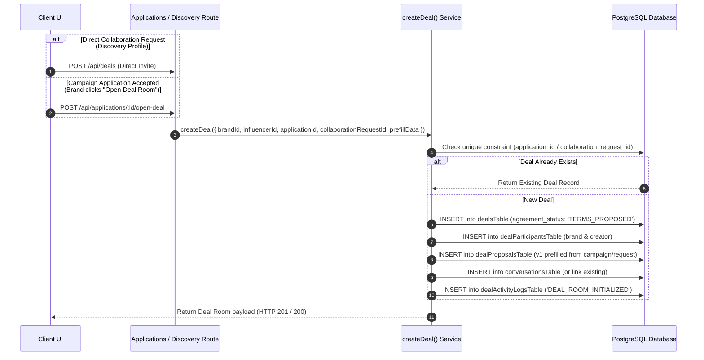
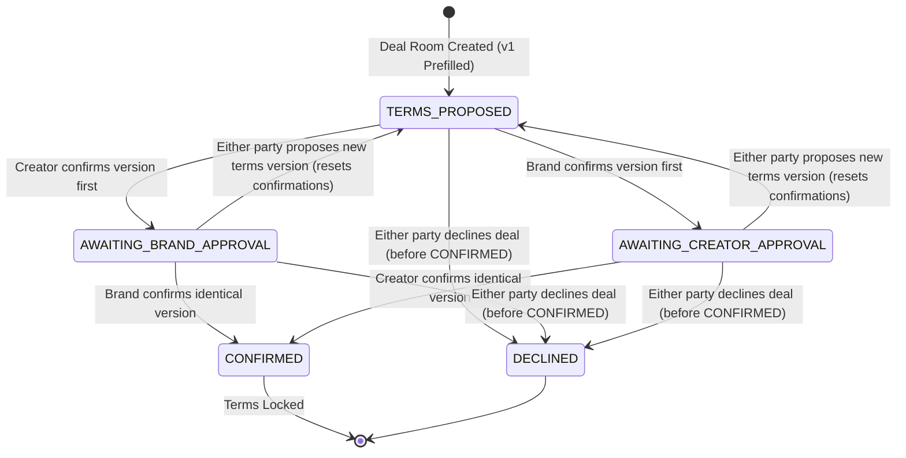
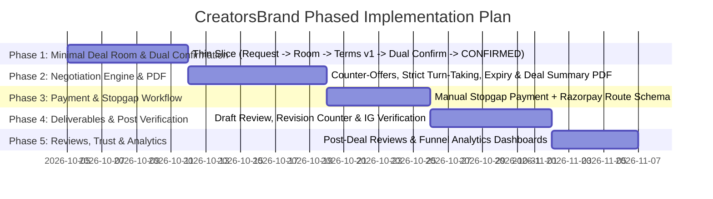

# CreatorsBrand — Deal Room Stage B Architecture Specification

> **Document Location:** `docs/deal-room-architecture-b.md`  
> **Status:** Stage B Complete (Architecture & Design Blueprint — Updated with Final Phase 1 Clarifications)  
> **Date:** 2026-10-04  

---

## Executive Summary & Stage B Design Principles

This specification presents the complete Stage B technical design for introducing **The Deal Room** into CreatorsBrand. Aligned with all Stage A decisions and Phase 1 clarifications, the system replaces 1-way catalog applications with an auditable, multi-track collaboration workspace.

### Core Architecture Directives:
1. **Decoupled Lifecycle Tracks:** Status is split into 3 independent tracks (`agreement_status`, `payment_status`, `execution_status`). The overall status (`overall_status`) is a pure derived function—never written directly to the database.
2. **Unified `createDeal()` Helper with Idempotency:** Both entry points (Direct Invitation and Campaign Application Convert) call a single server-side `createDeal()` function. Duplicate deals are prevented via unique constraints on `application_id` and `collaboration_request_id`.
3. **Immutable Versioned Terms & Fixed Schema:** Terms are stored as immutable numbered versions (`version: 1, 2, ...`). The schema is strictly typed. The terms hash (SHA-256) is generated using canonical JSON serialization (sorted keys, normalized whitespace) **server-side only**. `v1` is automatically prefilled from invitation/campaign data.
4. **Versioning Guards & Concurrency:** A proposed version must reference the current latest version as `baseVersion` (stale bases rejected with HTTP 409 Conflict). Max 20 versions per deal. Proposing does NOT auto-confirm for the author.
5. **Transactional Confirmation Integrity:** Confirmation runs inside a single database transaction (`SELECT FOR UPDATE`). Transition to `CONFIRMED` happens in the **same transaction** when both parties confirm the identical version. Includes race-condition test suites for parallel confirmation and confirm-vs-new-version contention.
6. **Strict Post-Confirmation Locking:** Once `CONFIRMED`, proposal creation endpoints reject with `"Terms are locked on a confirmed deal."` Cancelling is allowed ONLY before `CONFIRMED`.
7. **Zero-Trust Authz & IDOR Defense:** Every deal endpoint (proposals, approvals, activity logs, messages) enforces participant authorization: `deal.brandId === currentBrandId OR deal.influencerId === currentInfluencerId`.
8. **Phase 1 Exclusion Boundaries:** Counter-offer rounds, strict turn-taking rules, proposal expiration timeouts, PDF snapshot generation, and post-confirmation amendments are explicitly deferred to **Phase 2**.

---

## 1. System Architecture & Component Topology

```
├── database/src/schema/
│   ├── auth-schema.ts               [EXISTING] Better Auth user & session
│   ├── brands.ts & influencers.ts   [EXISTING] Brand & Creator profiles
│   ├── conversations.ts             [MODIFY] Add deal_id, message_type, metadata
│   ├── applications.ts              [MODIFY] Add optional deal_id
│   └── deals.ts                     [NEW] Deals, Proposals, Approvals, Deliverables, Payments, Activity Logs
├── backend/src/
│   ├── middlewares/auth.ts          [REUSE] requireAuth, requireRole ('brand'|'influencer')
│   ├── services/
│   │   ├── deal-creation.service.ts [NEW] Unified createDeal() helper with duplicate protection
│   │   ├── deal-status.service.ts   [NEW] Pure status derivation & state machine guards
│   │   ├── deal-proposal.service.ts [NEW] Immutable proposal versioning engine & canonical hashing
│   │   ├── deal-approval.service.ts [NEW] Transactional dual confirmation & race-condition guards
│   │   ├── deal-pdf.service.ts      [NEW] Deal Summary PDF generator (Phase 2 late)
│   │   └── social-verifier.service.ts[NEW] Read-only Instagram post URL matcher
│   └── routes/deals.ts              [NEW] Deal Room REST endpoints
└── frontend/src/
    ├── pages/deals/                 [NEW] Deal Room directory & tabbed workspace
    └── components/deals/            [NEW] Minimal Deal Summary Card, Terms Diff View, Confirmation Modals
```

---

## 2. Entry Points & Unified `createDeal()` Architecture



### Key Integration Rules:
- **Application Hook:** When a Brand accepts an application (`PATCH /api/applications/:id`), the application status updates to `accepted`. The brand UI displays an **"Open Deal Room"** button. Clicking it triggers `POST /api/applications/:id/open-deal`, which calls `createDeal()`. Existing application logic is untouched.
- **Duplicate Protection:** `dealsTable` enforces `UNIQUE INDEX idx_deals_application_id` and `UNIQUE INDEX idx_deals_collab_req_id`.

---

## 3. Decoupled Lifecycle Tracks & State Engine

### 3.1 Track A: Agreement State Machine (`agreement_status`)



### 3.2 Track D: Derived Overall Status (`overall_status`)
Pure function computed on fetch:

```typescript
export function deriveOverallStatus(
  agreement: AgreementStatus,
  payment: PaymentStatus,
  execution: ExecutionStatus
): DerivedOverallStatus {
  if (agreement === "DECLINED") return "DECLINED";
  if (agreement === "CANCELLED") return "CANCELLED";
  if (agreement === "EXPIRED") return "EXPIRED";
  if (agreement !== "CONFIRMED") return agreement; // TERMS_PROPOSED, AWAITING_BRAND_APPROVAL, AWAITING_CREATOR_APPROVAL

  // Agreement is CONFIRMED:
  if (payment === "DISPUTED") return "DISPUTED";
  if (execution === "COMPLETED" && (payment === "PAYOUT_RELEASED" || payment === "PAID_HELD")) return "COMPLETED";
  if (execution === "POST_VERIFIED" || execution === "FINAL_CONTENT_SUBMITTED") return "UNDER_REVIEW";
  if (execution === "DRAFTS_SUBMITTED" || execution === "REVISION_REQUESTED") return "IN_PROGRESS";
  if (payment === "PAID_HELD" || payment === "PAYMENT_PENDING") return "FUNDED";
  
  return "CONFIRMED";
}
```

---

## 4. Fixed Terms Schema & Server-Side Canonical Hashing

### 4.1 Fixed Terms Schema Specification
Every terms version in `deal_proposalsTable` adheres to a strict schema:

```typescript
export interface FixedProposalTerms {
  deliverables: Array<{
    title: string;       // e.g. "Instagram Reel"
    count: number;       // e.g. 1
    description?: string;
  }>;
  pricePaise: number;     // Integer paise in INR (e.g. 3500000 = ₹35,000)
  currency: "INR";        // Strictly 'INR'
  contentDeadline: string;// ISO 8601 Date
  postingDate: string;    // ISO 8601 Date
  usageRightsDays: number;// e.g. 30
  exclusivityDays: number;// e.g. 0
  revisionCount: number;  // e.g. 1
  notes?: string;         // Additional text notes
}
```

### 4.2 Server-Side Canonical Hash Function
To prevent client-side tampering, the `termsHash` is computed **exclusively on the server**:

```typescript
import crypto from "crypto";

export function computeCanonicalTermsHash(terms: FixedProposalTerms): string {
  // 1. Sort object keys deterministically
  const canonicalObj = {
    currency: terms.currency,
    deliverables: terms.deliverables.map(d => ({ count: d.count, title: d.title.trim() })).sort((a, b) => a.title.localeCompare(b.title)),
    exclusivityDays: terms.exclusivityDays,
    notes: (terms.notes || "").trim().replace(/\r\n/g, "\n"),
    postingDate: new Date(terms.postingDate).toISOString(),
    contentDeadline: new Date(terms.contentDeadline).toISOString(),
    pricePaise: terms.pricePaise,
    revisionCount: terms.revisionCount,
    usageRightsDays: terms.usageRightsDays,
  };

  // 2. Serialize to compact JSON with normalized whitespace
  const jsonString = JSON.stringify(canonicalObj);

  // 3. Compute SHA-256 hash
  return crypto.createHash("sha256").update(jsonString, "utf8").digest("hex");
}
```

---

## 5. Versioning Guards, Concurrency & Confirmation Integrity

### 5.1 Versioning Guards
- **Stale Base Prevention:** When submitting a new version (`POST /api/deals/:id/proposals`), the request body must specify `baseVersion`. The backend verifies `baseVersion === currentLatestVersion`. If stale, returns `HTTP 409 Conflict` (`"A newer terms version already exists. Please review the latest terms before proposing changes."`).
- **Proposing Does Not Auto-Confirm:** Submitting a new version sets the new proposal as active (`vN`), resets all existing confirmations, and sets `agreementStatus = 'TERMS_PROPOSED'`. It does NOT auto-confirm for the author.
- **Maximum Version Ceiling:** A deal permits a maximum of 20 versions (`version <= 20`). Submitting beyond 20 returns `HTTP 400 Bad Request`.
- **UI Diff View:** The UI renders a visual side-by-side Diff comparing `vN` vs `vN-1` with highlighted changes and displays a `"Waiting for <Brand/Creator> confirmation"` banner.

### 5.2 Transactional Confirmation Engine
The confirmation flow executes inside a single PostgreSQL database transaction using row-level locking (`SELECT ... FOR UPDATE`):

```typescript
export async function confirmDealTerms(
  dealId: number,
  proposalVersion: number,
  userId: string,
  userRole: "brand" | "influencer",
  reqMetadata: { ipAddress?: string; userAgent?: string }
): Promise<ConfirmResult> {
  return await db.transaction(async (tx) => {
    // 1. Lock deal record for update
    const [deal] = await tx.select().from(dealsTable).where(eq(dealsTable.id, dealId)).for("update");
    
    if (deal.agreementStatus === "CONFIRMED") {
      throw new Error("TERMS_LOCKED: Deal is already confirmed.");
    }

    // 2. Lock latest proposal record
    const [activeProposal] = await tx
      .select()
      .from(dealProposalsTable)
      .where(and(eq(dealProposalsTable.dealId, dealId), eq(dealProposalsTable.version, proposalVersion)))
      .for("update");

    if (!activeProposal || activeProposal.status !== "pending") {
      throw new Error("STALE_VERSION: The terms version you are trying to confirm is no longer active.");
    }

    const termsHash = computeCanonicalTermsHash(activeProposal.terms);

    // 3. Insert or update user's approval record
    await tx.insert(dealApprovalsTable).values({
      dealId,
      proposalId: activeProposal.id,
      proposalVersion,
      userId,
      party: userRole,
      termsHash,
      ipAddress: reqMetadata.ipAddress,
      userAgent: reqMetadata.userAgent,
    });

    // 4. Check existing approvals for THIS EXACT proposal version
    const existingApprovals = await tx
      .select()
      .from(dealApprovalsTable)
      .where(and(eq(dealApprovalsTable.dealId, dealId), eq(dealApprovalsTable.proposalId, activeProposal.id)));

    const brandConfirmed = existingApprovals.some((a) => a.party === "brand");
    const creatorConfirmed = existingApprovals.some((a) => a.party === "creator");

    let newStatus: AgreementStatus;

    if (brandConfirmed && creatorConfirmed) {
      newStatus = "CONFIRMED";
      await tx.update(dealsTable).set({
        agreementStatus: "CONFIRMED",
        confirmedAt: new Date(),
        updatedAt: new Date(),
      }).where(eq(dealsTable.id, dealId));

      await tx.update(dealProposalsTable).set({ status: "accepted" }).where(eq(dealProposalsTable.id, activeProposal.id));
    } else if (userRole === "brand") {
      newStatus = "AWAITING_CREATOR_APPROVAL";
      await tx.update(dealsTable).set({ agreementStatus: "AWAITING_CREATOR_APPROVAL", updatedAt: new Date() }).where(eq(dealsTable.id, dealId));
    } else {
      newStatus = "AWAITING_BRAND_APPROVAL";
      await tx.update(dealsTable).set({ agreementStatus: "AWAITING_BRAND_APPROVAL", updatedAt: new Date() }).where(eq(dealsTable.id, dealId));
    }

    return { success: true, agreementStatus: newStatus, confirmed: brandConfirmed && creatorConfirmed };
  });
}
```

### 5.3 Automated Concurrency & Race Condition Test Suites
The automated test suite (`src/__tests__/deal-concurrency.test.ts`) tests:
1. **Parallel Confirm Test:** Both Brand and Creator trigger `/confirm` concurrently for `v1`. The transaction locks prevent race conditions, resulting cleanly in `CONFIRMED`.
2. **Confirm vs. New Version Race Test:** Brand triggers `/confirm` for `v1` while Creator simultaneously triggers `/proposals` (proposing `v2`). Transaction order guarantees that if `v2` inserts first, Brand's `v1` confirmation fails with `STALE_VERSION`, properly resetting confirmations.

---

## 6. Post-Confirmation Controls & Authorization (Authz)

- **Post-Confirmation Terms Lock:** Once `dealsTable.agreementStatus === 'CONFIRMED'`, calls to `POST /api/deals/:id/proposals` are rejected with `HTTP 400 Bad Request`: `"Terms are locked on a confirmed deal. Amendments will be supported in Phase 2."` The UI displays a banner noting that deal amendments will arrive in Phase 2.
- **Cancellation Boundary:** Deal cancellation (`PATCH /api/deals/:id/cancel`) is permitted **only before** `CONFIRMED`.
- **Zero-Trust Participant Authorization:** Every deal API (terms, proposals, approvals, activity logs, messaging) enforces:
  ```typescript
  const isParticipant = (deal.brandId === userBrandId) || (deal.influencerId === userInfluencerId);
  if (!isParticipant) {
    return res.status(403).json({ error: "Forbidden: You are not a participant in this Deal Room." });
  }
  ```
  *Automated IDOR security tests (`src/__tests__/deal-idor-security.test.ts`) verify that User C cannot access Deal AB.*

---

## 7. Funnel Analytics Event Matrix

The platform records the following auditable funnel analytics events in `dealActivityLogsTable` and dispatches analytics telemetry:

| Analytics Event Key | Trigger Condition | Payload Metadata |
| :--- | :--- | :--- |
| `deal_room_created` | Deal initialized via invite or application | `{ dealId, brandId, influencerId, source: 'direct_invite' \| 'application' }` |
| `proposal_version_created` | New terms version submitted | `{ dealId, version, pricePaise, proposedByParty: 'brand' \| 'creator' }` |
| `terms_version_confirmed` | User confirms a specific version | `{ dealId, version, party: 'brand' \| 'creator', termsHash }` |
| `deal_confirmed` | Both parties confirm same version | `{ dealId, version, termsHash, confirmedAt }` |
| `deal_cancelled` | User cancels deal prior to confirmation | `{ dealId, cancelledByParty, reason }` |
| `first_message_sent` | First chat message posted in Deal Room | `{ dealId, conversationId, senderId }` |

---

## 8. Database Schema Specifications `[NEW]`

### 8.1 `deals` Table
```typescript
export const dealsTable = pgTable("deals", {
  id: serial("id").primaryKey(),
  brandId: integer("brand_id").notNull().references(() => brandsTable.id, { onDelete: "cascade" }),
  influencerId: integer("influencer_id").notNull().references(() => influencersTable.id, { onDelete: "cascade" }),
  campaignId: integer("campaign_id").references(() => campaignsTable.id, { onDelete: "set null" }),
  applicationId: integer("application_id").references(() => applicationsTable.id, { onDelete: "set null" }),
  conversationId: integer("conversation_id").references(() => conversationsTable.id, { onDelete: "set null" }),
  
  title: text("title").notNull(),
  
  // Track Statuses
  agreementStatus: text("agreement_status", {
    enum: ["DRAFT", "INVITED", "TERMS_PROPOSED", "AWAITING_BRAND_APPROVAL", "AWAITING_CREATOR_APPROVAL", "CONFIRMED", "DECLINED", "CANCELLED", "EXPIRED"]
  }).notNull().default("TERMS_PROPOSED"),
  
  paymentStatus: text("payment_status", {
    enum: ["UNFUNDED", "PAYMENT_PENDING", "PAID_HELD", "PAYOUT_RELEASED", "REFUNDED", "DISPUTED"]
  }).notNull().default("UNFUNDED"),
  
  executionStatus: text("execution_status", {
    enum: ["NOT_STARTED", "IN_PROGRESS", "DRAFTS_SUBMITTED", "REVISION_REQUESTED", "FINAL_CONTENT_SUBMITTED", "POST_VERIFIED", "COMPLETED"]
  }).notNull().default("NOT_STARTED"),

  activeProposalId: integer("active_proposal_id"),
  pdfSummaryUrl: text("pdf_summary_url"),

  confirmedAt: timestamp("confirmed_at", { withTimezone: true }),
  createdAt: timestamp("created_at", { withTimezone: true }).notNull().defaultNow(),
  updatedAt: timestamp("updated_at", { withTimezone: true }).notNull().defaultNow(),
}, (table) => [
  uniqueIndex("idx_deals_application_id").on(table.applicationId),
]);
```

### 8.2 `deal_participants` Table
```typescript
export const dealParticipantsTable = pgTable("deal_participants", {
  id: serial("id").primaryKey(),
  dealId: integer("deal_id").notNull().references(() => dealsTable.id, { onDelete: "cascade" }),
  userId: text("user_id").notNull().references(() => user.id, { onDelete: "cascade" }),
  party: text("party", { enum: ["brand", "creator"] }).notNull(),
  role: text("role", { enum: ["primary_owner", "collaborator", "approver"] }).notNull().default("primary_owner"),
  createdAt: timestamp("created_at", { withTimezone: true }).notNull().defaultNow(),
});
```

### 8.3 `deal_proposals` Table
```typescript
export const dealProposalsTable = pgTable("deal_proposals", {
  id: serial("id").primaryKey(),
  dealId: integer("deal_id").notNull().references(() => dealsTable.id, { onDelete: "cascade" }),
  version: integer("version").notNull().default(1),
  previousProposalId: integer("previous_proposal_id"),

  offeredByParty: text("offered_by_party", { enum: ["brand", "creator"] }).notNull(),
  offeredByUserId: text("offered_by_user_id").notNull(),

  totalAmountPaise: integer("total_amount_paise").notNull(),
  currency: text("currency").notNull().default("INR"),
  
  deliverables: jsonb("deliverables").$type<Array<{
    title: string;
    count: number;
    description?: string;
  }>>().notNull(),

  contentDeadline: timestamp("content_deadline", { withTimezone: true }).notNull(),
  postingDate: timestamp("posting_date", { withTimezone: true }).notNull(),

  usageRightsDays: integer("usage_rights_days").notNull().default(30),
  exclusivityDays: integer("exclusivity_days").notNull().default(0),
  categoryExclusivity: text("category_exclusivity"),
  revisionCount: integer("revision_count").notNull().default(1),
  notes: text("notes"),

  status: text("status", {
    enum: ["pending", "accepted", "superceded", "withdrawn", "rejected"]
  }).notNull().default("pending"),
  
  createdAt: timestamp("created_at", { withTimezone: true }).notNull().defaultNow(),
});
```

### 8.4 `deal_approvals` Table
```typescript
export const dealApprovalsTable = pgTable("deal_approvals", {
  id: serial("id").primaryKey(),
  dealId: integer("deal_id").notNull().references(() => dealsTable.id, { onDelete: "cascade" }),
  proposalId: integer("proposal_id").notNull().references(() => dealProposalsTable.id, { onDelete: "cascade" }),
  proposalVersion: integer("proposal_version").notNull(),
  
  userId: text("user_id").notNull(),
  party: text("party", { enum: ["brand", "creator"] }).notNull(),
  
  termsHash: text("terms_hash").notNull(),
  approvedAt: timestamp("approved_at", { withTimezone: true }).notNull().defaultNow(),
  ipAddress: text("ip_address"),
  userAgent: text("user_agent"),
});
```

---

## 9. Recommended Phased Implementation Roadmap



---

### End of Stage B Specification
*This document incorporates all Phase 1 clarifications and represents the complete Stage B design blueprint. Ready to proceed with Phase 1 execution upon your command.*
